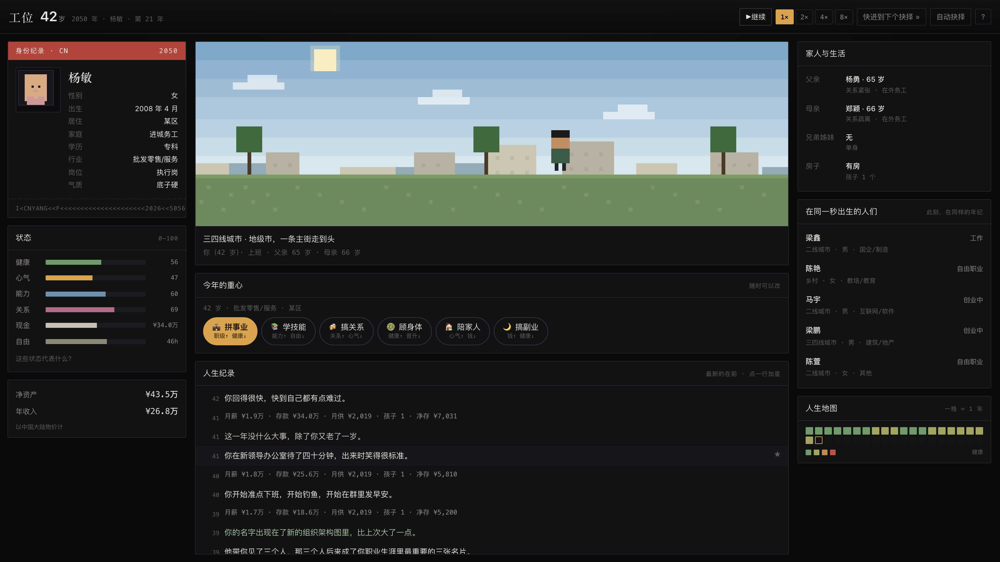
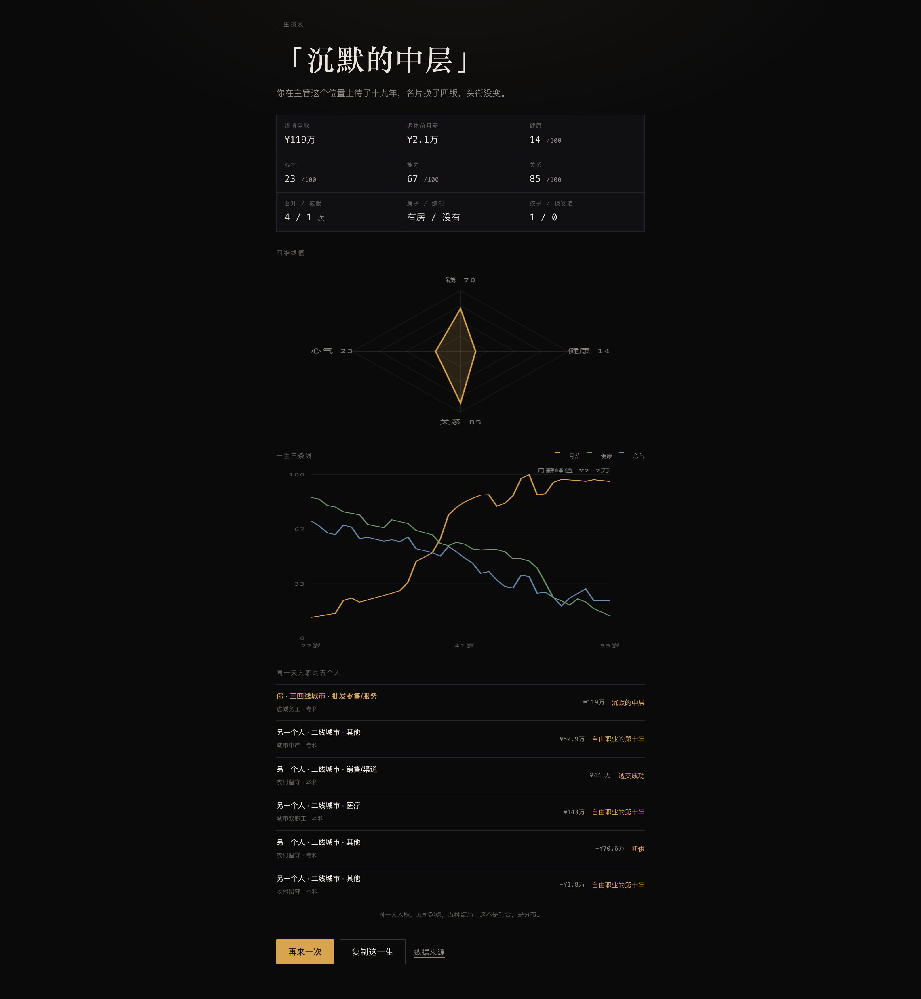
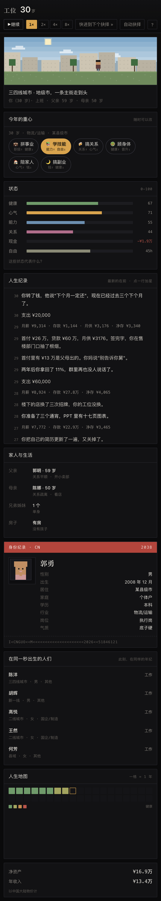

# 工位 · 1 in 740 Million

一个仿 [1in8b.life](https://1in8b.life/) 的**中国职场模拟器**。纯前端、无后端、无跟踪，双击 `index.html` 就能玩。

> 中国有约 7.4 亿就业人口。你被随机丢进其中一个工位，从 22 岁干到退休。
> 中间只有九次真正能改命的岔路，其余时间你只是在选：今年把命花在哪。

---

## 怎么玩

直接双击 `index.html`（Safari / Chrome 均可）。

如果想用本地服务器：

```bash
cd 04_tools/gongwei
python3 -m http.server 8080
# 打开 http://localhost:8080
```

存档在浏览器 `localStorage`（键名 `gongwei.save.v1`），关掉页面再回来可以「继续上一条命」。

**操作**：点六个重心按钮，或按键盘 `1`–`6`；空格切换自动播放。

## 截图

| 封面 | 游戏中（三栏面板） |
|---|---|
|  |  |

| 结算 | 手机端 |
|---|---|
|  |  |

---

## 已上线

独立仓库、独立站点，和「主观交易指南」完全分开：

**https://lovel0ri.github.io/gongwei/** · 源码 <https://github.com/Lovel0ri/gongwei>

推送方式（SSH，仓库根目录就是站点根目录）：

```bash
git clone git@github.com:Lovel0ri/gongwei.git
cd gongwei
# 把这里的 index.html / css / js / screenshots 同步进去
git add -A
git commit -m "update: 工位"
git push origin main
```

约半分钟后 Pages 自动重建。注意：

- 仓库根目录已有 `.nojekyll`，GitHub 不会走 Jekyll 处理。
- 存档用 `localStorage`，按域名隔离：`file://`、`https://lovel0ri.github.io`、`localhost` 是三套互不通用的存档。
- 想挂到自定义域名，加一个 `CNAME` 文件并在域名商那边加 CNAME 记录即可，代码不用改。

---

## 界面

仿 1in8b 的三栏面板：

- **顶栏**：年龄 / 年份 / 姓名 · `继续`（自动推进）· `1× 2× 4× 8×` 速度 · `快进到下个抉择` · `自动抉择`
- **左栏**：身份纪录（像素头像、性别、出生、居住、家庭、学历、行业、岗位、气质、MRZ 式编号）· 六条状态 · 净资产 / 年收入
- **中栏**：像素场景（按城市能级和昼夜程序化生成）· 今年的重心（六个带效果标签的 chip）· 人生纪录（最新在前，可点星标）
- **右栏**：家人与生活（父母年龄/职业/关系、房子、孩子）· 在同一秒出生的人们（5 个人，实时状态）· 人生地图（一格一年，按健康上色）

手机端自动叠成单列，顺序是：场景 → 重心 → 状态 → 人生纪录 → 家人 → 身份 → 同秒 → 地图。

---

## 一局的结构

```
抽签（出生地/家庭/高考分数/行业/岗位/体质）
  → 18 岁 填志愿
  → 19 岁 大学四年（或直接进入社会）
  → 22 岁 第一份工作
  → 每年选一个「重心」，共 38 年
  → 26 / 29 / 32 / 35 / 40 / 45 / 52 岁 七次岔路
  → 60 岁 结算：结局 + 四维雷达 + 一生三条线 + 同秒五人对照
```

核心机制：

- **起点不可选**：出生地、家庭、分数、行业全部按分布抽，玩家一次都不能改。
- **每年只选一个重心**：拼事业 / 学技能 / 搞关系 / 顾身体 / 陪家人 / 搞副业。每个都明码标价，都至少扣一维。
- **健康延迟结算**：35 岁前几乎不掉，45 岁后开始寄账单。
- **结构性约束**：抽到县域 + 中专，最好结局也有上限；努力只在区间内生效。
- **没有最优解**：所有选项都在某一维度上收费。

---

## 目录结构

```
gongwei/
├── index.html            入口（封面 / 抽签 / 游戏 / 结算 / 关于）
├── css/style.css         样式
├── js/
│   ├── data.core.js      meta、地区、抽签表、重心、结局名、数据来源、风味文本
│   ├── data.events.js    34 张事件卡
│   ├── data.nodes.js     10 个人生节点（九次岔路 + 大学四年）
│   ├── engine.js         纯函数引擎：抽签 / 年度结算 / 事件 / 节点 / 结局判定
│   ├── sim.js            无头模拟器（同秒五人、批量平衡测试）
│   └── ui.js             界面控制、图表、存档
├── 设计大纲.md            设计文档（世界观、机制、伦理边界）
└── README.md
```

### 数据结构里的 region

所有表都是 `{ CN: [...] }` 的形状，`D.meta.region` 决定默认地区：

```js
D.cityTiers = { CN: [ ... ] }
D.industries = { CN: [ ... ] }
D.families   = { CN: [ ... ] }
```

要加一个地区，只要新增 `US: [...]` 等键，并把 `meta.region` 换成对应值即可。引擎里所有取值都走 `S.region`，不写死中国。

---

## 平衡与调试

引擎不依赖 DOM，可以直接在 node 里跑批量模拟：

```bash
node -e "
const p='./js/';
['data.core','data.events','data.nodes','engine','sim'].forEach(f=>require(p+f+'.js'));
const b=globalThis.GW.Sim.batch(600);
console.log(b.dist);
"
```

会输出 600 条命的结局分布、存款/健康/心气等分位数，用来调阈值。

主要平衡旋钮：

| 想调什么 | 改哪里 |
|---|---|
| 起薪高低 | `engine.js` `createLife` 里的 `6200` |
| 涨薪速度 | `stepYear` 的 `0.033 * cycleAdj * ageDecay` |
| 晋升频率 | `promoP` 的系数与 `0.08` 上限 |
| 裁员概率 | `layP` 里的 `0.42` 系数 |
| 健康衰减 | `dH` 的 `-0.06` 与 `(hours-45)*0.035` |
| 心气衰减 | `dS` 的 `-0.05` 与 `mismatch` 系数 |
| 房价 | `applyNodeOption` 里的 `unitPrice` 与 `8 倍年收入` |
| 结局判定 | `evaluate` 里的阈值顺序 |

---

## 数据与边界

游戏内「关于」页列出了全部数据来源，原则是：**官方数据优先，平台样本标注，估算写成估算**。

- 分行业工资、周工时、调查失业率、可支配收入：国家统计局统计公报 / 统计年鉴
- 行业、职业、学历结构：第七次全国人口普查
- 35 岁门槛、跳槽涨幅：智联 / BOSS / 脉脉年度报告（平台样本）
- 健康与过劳风险：卫健统计年鉴与相关流行病学研究

所有数值是按公开统计**标定的近似参数**，用于模拟趋势，不构成收入、职业或投资建议。

**伦理红线**：不美化 996，也不猎奇苦难；抑郁、过劳、疾病只呈现结果不写细节；结局不做道德评判。

---

## 版本

- v0.2.0 — 重做界面为三栏面板：像素场景、身份卡、同秒出生的人、人生地图、自动推进与倍速；新增姓名/性别/父母/家庭关系。
- v0.1.0 — 首版：抽签、38 年循环、9 次岔路、34 张事件卡、12 种结局、四维雷达与一生曲线、同秒五人对照、本地存档。

---

## 已知取舍

- 通胀、利率、房价都用固定近似值，没有接入真实时间序列。
- 同秒五人是本地即时模拟，不联网，所以每次看到的「别人」都不同。
- 没有做分享图生成（只做了「复制这一生」文本）。
